  

  
  
  
  

### ✦ hi, i'm josh

CS student at **Ontario Tech** in Whitby, ON. I work on backend and infrastructure: APIs, databases, containers and the CI pipelines around them. Before uni I did IT support at a managed service provider, imaging about 100 machines for about 40 small businesses, which is where **OpsWatch** came from.

Off the clock I make soul beats, cut the occasional edit, read too much manhwa and lift.

**right now**

- looking for a **Winter 2027 co-op** in backend, cloud or infrastructure
- building **[OpsWatch](https://github.com/JMScripts1/opswatch)**, self-hosted IT health monitoring
- happy to talk about Python, Docker and SQL, or why your PC won't boot

### ✦ projects

  

  

Game Deal Tracker also has a <a href="https://jmscripts1.github.io/game-deal-tracker/">live page</a>.

### ✦ résumé

  

<a href="https://jmscripts1.github.io/assets/Joshua_Mathias_Resume.pdf"><b>full résumé (PDF)</b></a>

### ✦ toolbox

  

### ✦ on github

  
  

  

<!-- The cards in assets/ are built by scripts/build_cards.py. Edit the CONTENT section there and re-run it. -->
